<picture>
  <source media="(prefers-color-scheme: dark)" srcset="./assets/banner-dark.svg">
  
</picture>

<i>Trying to give back something to the community.</i>

  
  
  
  
  
  
  

## 👋 Hi, I'm HawkForge

I work on open source. I look for bugs that people actually run into, trace each one back to its root cause, and send a small fix with a test that proves it. Most of it is PHP and TypeScript, with some Go along the way.

## 🛠️ How I work

- **Root cause first.** Fix why it breaks, not only where it shows.
- **Proof in a test.** Every fix comes with a test that fails without it.
- **Small diffs.** No drive-by reformatting, no unrelated changes.
- **Respect the maintainers.** Follow the project's guide and style, and keep up with reviews.

## 🔭 Right now

Most of my time goes to [**dompdf**](https://github.com/dompdf/dompdf), the HTML to PDF library for PHP: fixing font handling and HTML5 parsing bugs, and helping it support more modern CSS.

## ✅ Some merged fixes

| Project | What got fixed | PR |
| :-- | :-- | :-: |
| [Symfony](https://github.com/symfony/symfony) | PropertyAccess works with custom `PropertyPathInterface` implementations | [#66932](https://github.com/symfony/symfony/pull/66932) |
| [Ghost](https://github.com/TryGhost/Ghost) | Portal, Search and Comments load on self-hosted sites | [#31968](https://github.com/TryGhost/Ghost/pull/31968) |
| [tRPC](https://github.com/trpc/trpc) | Inferred types stay portable when `baseUrl` isn't set | [#7662](https://github.com/trpc/trpc/pull/7662) |
| [eslint-plugin-react](https://github.com/jsx-eslint/eslint-plugin-react) | `prop-types` and `prefer-read-only-props` resolve props typed with a namespace-qualified name | [#4052](https://github.com/jsx-eslint/eslint-plugin-react/pull/4052) |
| [PhpSpreadsheet](https://github.com/PHPOffice/PhpSpreadsheet) | Correct branch pruning for an `IF` nested in the condition of a pruned `IF` | [#5055](https://github.com/PHPOffice/PhpSpreadsheet/pull/5055) |
| [goja](https://github.com/dop251/goja) | `JSON.stringify` indents correctly after an empty array or object | [#800](https://github.com/dop251/goja/pull/800) |
| [Milkdown](https://github.com/Milkdown/milkdown) | Prices like `$5` and `$10` no longer turn into inline math | [#2497](https://github.com/Milkdown/milkdown/pull/2497) |
| [docx](https://github.com/dolanmiu/docx) | Restarting a numbering instance restarts every level, not only the first | [#3768](https://github.com/dolanmiu/docx/pull/3768) |
| [Craft CMS](https://github.com/craftcms/cms) | Renaming an asset without an extension keeps its file extension | [#19968](https://github.com/craftcms/cms/pull/19968) |
| [Flarum](https://github.com/flarum/framework) | Negated filters stay intact in `GambitManager.from()` | [#5202](https://github.com/flarum/framework/pull/5202) |
| [Redocly CLI](https://github.com/Redocly/redocly-cli) | The `file` type is allowed in OpenAPI 2.0 response schemas | [#3255](https://github.com/Redocly/redocly-cli/pull/3255) |
| [UniGetUI](https://github.com/Devolutions/UniGetUI) | Honors `BUN_INSTALL` and `BUN_INSTALL_GLOBAL_DIR` for Bun global packages | [#5532](https://github.com/Devolutions/UniGetUI/pull/5532) |

…and more in Grav, File Browser, eslint-plugin-ember, FreshRSS, PHPStan and Spatie. [**See all merged PRs →**](https://github.com/pulls?q=is%3Apr+author%3AHawkForge+is%3Amerged+-user%3AHawkForge+-user%3Abyteminus+-user%3AuglyOrcs)

---

If one of these fixes saved you some time, that's the whole point. ⭐

